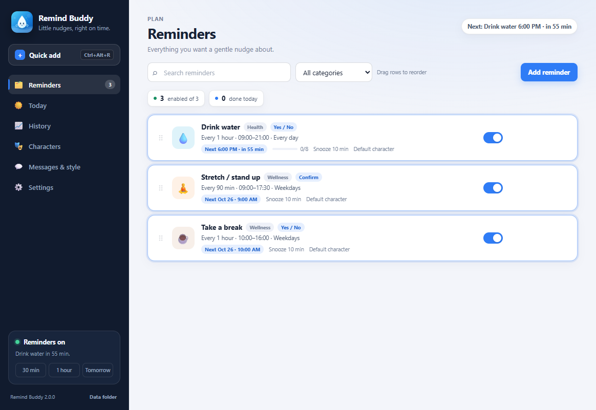
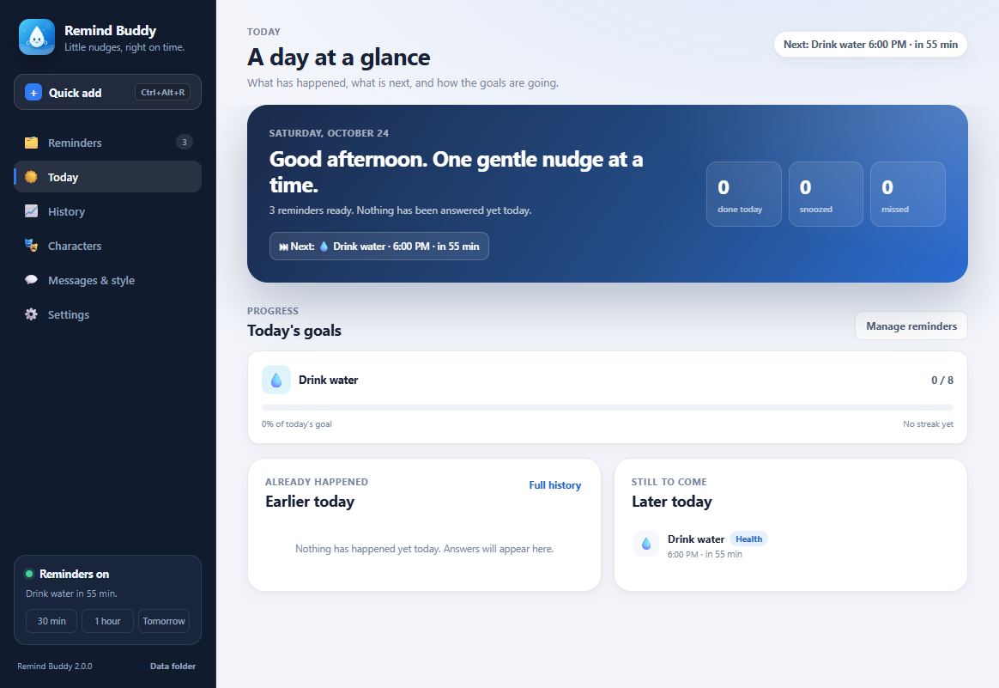
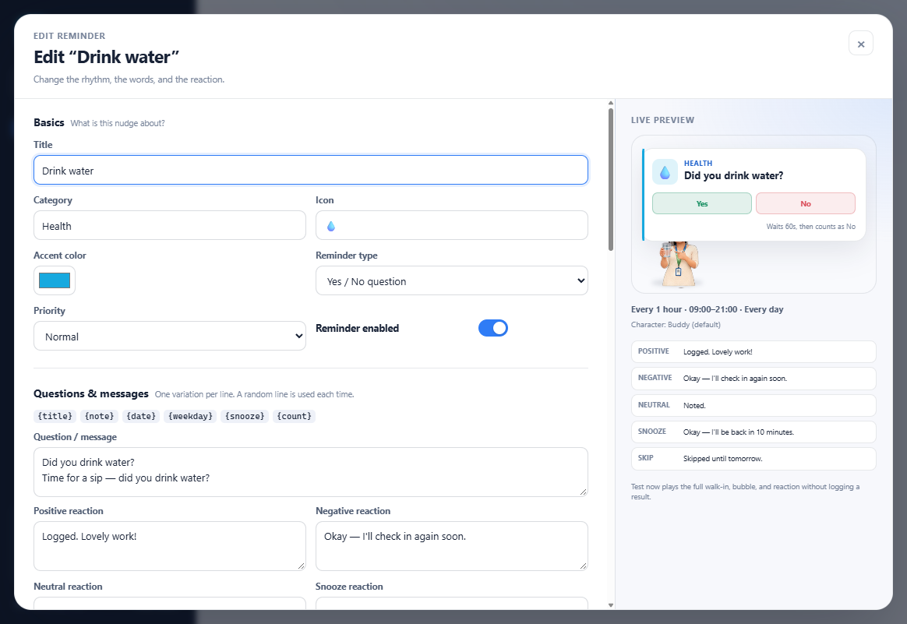
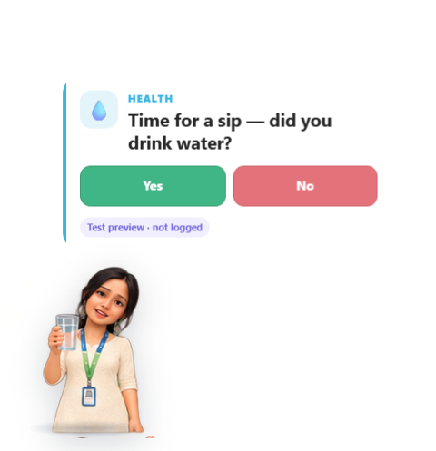
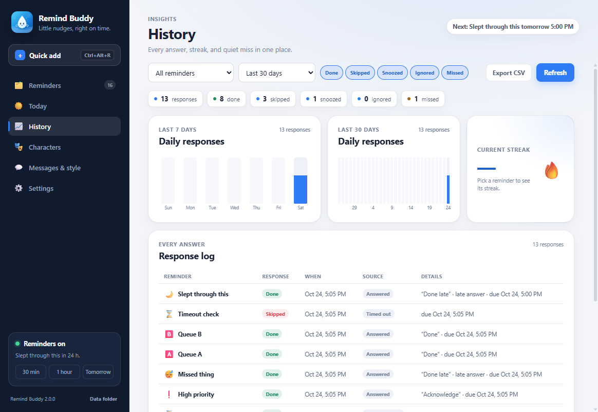
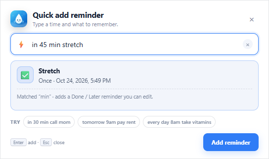
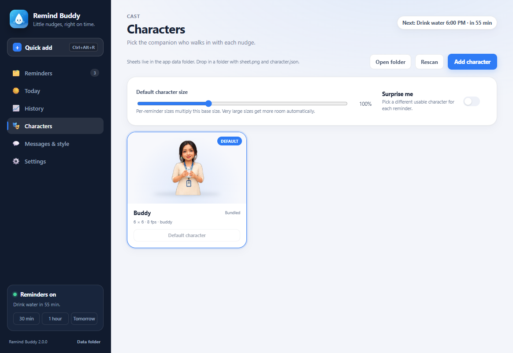
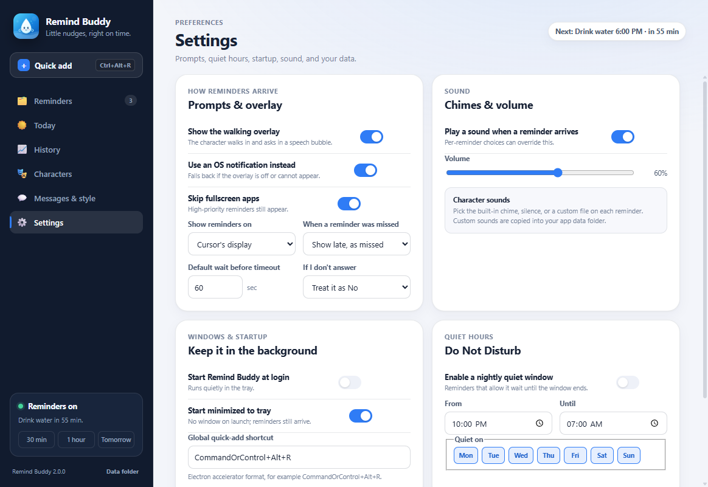
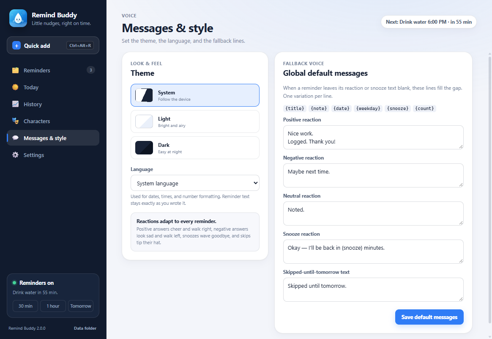

# Remind Buddy

A friendly desktop reminder for anything you want to stay on top of. A small animated character walks in with your message, waits for an answer, and reacts to what you choose. Water is just one of the built-in templates.

Built with Electron. Lives in the system tray on Windows, macOS, and Linux.



## Contents

- [What it does](#what-it-does)
- [Screenshots](#screenshots)
- [Reminder types](#reminder-types)
- [Templates](#templates)
- [Scheduling and delivery](#scheduling-and-delivery)
- [Quick add](#quick-add)
- [Today and history](#today-and-history)
- [Characters and reactions](#characters-and-reactions)
- [Messages and style](#messages-and-style)
- [Settings](#settings)
- [Data, backup, and migration](#data-backup-and-migration)
- [Install and run](#install-and-run)
- [Tests](#tests)
- [Build installers](#build-installers)
- [Platform notes](#platform-notes)
- [Architecture and security](#architecture-and-security)
- [License](#license)

## What it does

- **Many reminders, one buddy.** Create as many reminders as you need. Each has its own title, icon, color, category, schedule, message lines, buttons, character, sound, and reactions.
- **Five prompt styles.** Ask a yes/no question, confirm one thing, offer two to four choices, run a countdown timer, or show a message-only note.
- **Seven schedule types.** Repeat at an interval, fire at fixed times, run monthly, fire once (optionally every year), greet you after startup, nudge you after idle time, or follow a Pomodoro rhythm.
- **Real-world gating.** Active hours (including overnight windows), active weekdays, start/end dates, pause, Do Not Disturb, screen lock, and fullscreen apps all shape when prompts can appear.
- **One prompt at a time.** Reminders that come due together are queued with a short gap instead of stacking on screen. Missed prompts catch up after sleep or a locked screen.
- **Animated reactions.** Positive answers cheer and walk right, negative answers look sad and leave left, neutral answers nod, snoozes wave goodbye, and skips tip their hat until tomorrow.
- **History that adds up.** See today's timeline and goals, response streaks, 7- and 30-day charts, and a filterable log that exports to CSV.
- **Quick add from anywhere.** Press <kbd>Ctrl</kbd>+<kbd>Alt</kbd>+<kbd>R</kbd> (configurable) or use the tray, type “in 30 min call mom”, and the reminder is scheduled.
- **Local and private.** Settings, reminders, and history stay in local JSON files. There is no account, telemetry, or network access. Backups, import/restore, and an optional sync-folder snapshot are built in.

## Screenshots

| Reminders | Today |
| --- | --- |
|  |  |
| **Reminder editor with live preview** | **Prompt with a test preview** |
|  |  |
| **Positive reaction** | **History and charts** |
|  |  |
| **Quick add** | **Characters** |
|  |  |
| **Settings** | **Messages and fallback style** |
|  |  |

## Reminder types

| Type | What it shows | Default buttons |
| --- | --- | --- |
| **Yes / No** | A question with two answers. Water uses this. | Yes (positive), No (negative) |
| **Confirm** | A task check like “Done” and “Later”. | Done (positive), Later (snooze) |
| **Choice** | Two to four custom buttons, each with its own label and reaction. | You define them |
| **Timer** | A visible countdown that ends in a happy finish and a completed entry. | Done, Snooze |
| **Note** | A short message with no buttons; dismisses itself. | None |

Every button maps to one of five behaviors: **positive**, **negative**, **neutral**, **snooze**, or **skip**. Notes dismiss when their display time ends. Timers count down visibly, complete themselves at zero, and log a positive outcome. A timeout can be configured per reminder to **treat as negative**, **snooze**, or **dismiss**; high-priority reminders never time out.

## Templates

Every template is editable after you add it. Adding a template creates a normal reminder with sensible defaults.

| Template | Default schedule | Notes |
| --- | --- | --- |
| Drink water | Every 60 min, 09:00–21:00 | Daily goal of 8, drinking reaction, 10-minute snooze |
| Take medicine | 08:00 and 20:00 daily | High priority, confirmation, "take with water" note |
| Stretch / stand up | Every 90 min on weekdays | Exercise reaction when the sheet supports it |
| 20-20-20 eye rest | Every 20 min on weekdays | Auto-dismissing note, no logging, soft chime |
| Check posture | Every 30 min on weekdays | Yes/no prompt |
| Eat meal / snack | 08:00, 12:30, 18:30 daily | Goal of 3 |
| Walk | 10:00 and 15:00 daily | Exercise reaction |
| Take a break | Every 60 min, 10:00–16:00 on weekdays | Yes/no prompt |
| Go to sleep | 22:30 daily | Wind-down confirmation |
| Study / focus session | Pomodoro: 25 min focus, 5 min break | Alternating focus and break notes |
| Pay bills / rent | Monthly on day 1 at 09:00 | High priority, missed prompts are shown |
| Birthday / anniversary | Next month, then yearly | Auto-dismissing celebration note |
| Custom reminder | Every 60 min, 09:00–21:00 | Blank starting point |

## Scheduling and delivery

Each reminder's schedule supports:

| Kind | Behavior |
| --- | --- |
| **Interval** | Repeat every 5 minutes to 7 days inside an active window. Overnight windows such as 22:00–02:00 work. |
| **Fixed times** | Up to 12 local times per day, on chosen weekdays. |
| **Monthly** | A chosen day of the month at one or more times. Months without that day are skipped. |
| **Once** | A specific local date and time, with an optional yearly repeat. |
| **After startup** | Fires once per launch after a delay. |
| **After idle** | Fires when the system has been idle for a chosen period, inside active hours. |
| **Pomodoro** | Alternates focus and break prompts with configurable lengths. |

Common schedule controls:

- **Active hours** per reminder, including windows that cross midnight.
- **Active days** per reminder, plus optional overall start and end dates.
- **Skip conditions** for pause, Do Not Disturb, and screen lock. High-priority reminders ignore pause and can still appear over fullscreen apps.
- **Missed policy** per reminder: ask the global rule, show late with a “missed” badge, or skip.
- **Snooze**: minutes, maximum snoozes, and optional escalation (frequent reminders or a bigger entrance).
- **One prompt at a time**: simultaneous reminders enter a queue with a three-second gap, in priority and due-time order. Missed prompts go to the front.
- **Recovery**: the schedule is recalculated after sleep, unlock, clock/DST changes, display changes, reminder edits, and a periodic heartbeat. A prompt missed while the computer slept appears with its late answer still available.

**Priority** is per reminder. High-priority prompts stay until answered, bypass pause, and appear over fullscreen apps even when “skip fullscreen apps” is on. Everything else respects those guards.

## Quick add

Press <kbd>Ctrl</kbd>+<kbd>Alt</kbd>+<kbd>R</kbd> (or <kbd>Command</kbd>+<kbd>Option</kbd>+<kbd>R</kbd> on macOS), use **Quick add** in the sidebar, or choose **Quick add…** from the tray. A live description shows exactly when the reminder will fire before you save.

Examples:

```
in 30 min call mom
in 2 hours turn off the oven
tomorrow 9am pay rent
tonight 8pm water the plants
monday 10:00 send the report
on the 15th 9am pay the card
on 2026-12-24 18:00 wrap presents
every day 9am take vitamins
every weekday 8:30 stand-up
every weekend 10am long walk
every friday 16:00 submit hours
every 45 min stretch
17:30 call the dentist
send the invoice at 3pm
```

Quick add creates a confirmation reminder with **Done** and **Later** buttons. You can edit it like any other reminder afterward.

## Today and history

The **Today** tab shows the day's next prompt, a timeline of what is due, and progress toward each reminder's daily goal. The **History** tab provides:

- response filters by reminder, time range, and outcome (done, skipped, snoozed, ignored, missed);
- totals and a current completion streak per reminder;
- 7-day and 30-day daily response charts;
- a response log with source, answer, and lateness;
- CSV export of the filtered log.

History keeps 366 days and up to 50,000 events. Test previews are never written to history. Notes that dismiss themselves are not logged; answering a normal prompt is.

## Characters and reactions

Reactions are driven by the button's behavior:

| Behavior | Animation | Result |
| --- | --- | --- |
| Positive | Happy, then walk out to the right | Logged as done |
| Negative | Sad, then sad-walk out to the left | Logged as skipped |
| Neutral | A nod, then walk out to the right | Logged as done |
| Snooze | Waves, then leaves left and returns later | Logged as snoozed |
| Skip | Tips hat and leaves left until tomorrow | Logged as skipped until tomorrow |

The **Drink water** template adds a drinking animation before the happy finish when the character sheet includes it. A reminder can optionally use a **drinking** or **exercise** special animation; if the current sheet lacks that row, the app falls back to happy rather than failing.

Characters are plain folders containing a sprite sheet:

```
assets/character/          bundled with the app (read-only in an installed build)
  buddy/
    sheet.png
    character.json         optional layout config
    preview.png            optional thumbnail

<userData>/characters/     your characters (see Data, backup, and migration)
  robot/
    sheet.png
    ...
```

Both folders are scanned at startup and on **Rescan**; user characters override bundled folders with the same name. Characters added in the app are copied into the per-user folder, so they survive updates. Each reminder can use the default character, a specific character, or a random one, with a size from 50% to 200% relative to the global base size (combined sizes are capped automatically).

### Default sheet layout

Without `character.json`, a sheet is a 6×6 grid of equal cells:

| Row | Animation |
| --- | --- |
| 1 | Walk |
| 2 | Sad walk |
| 3 | Idle asking |
| 4 | Happy |
| 5 | Sad |
| 6 | Drinking |

Six frames play from each row at 8 fps. The character faces right and is mirrored when walking left. Cells can be any size as long as the sheet divides evenly. Transparent PNGs work directly; flat green-screen borders are keyed and despilled automatically. Optional rows and per-animation frame counts are supported, including an exercise row used by the stretch and walk templates.

Example `character.json`:

```json
{
  "name": "Buddy",
  "columns": 6,
  "rows": 6,
  "fps": 8,
  "scale": 1.0,
  "facing": "right",
  "rows_map": {
    "walk": 1, "sad_walk": 2, "idle": 3,
    "happy": 4, "sad": 5, "drinking": 6
  },
  "frames_per_row": {
    "walk": 6, "sad_walk": 6, "idle": 6,
    "happy": 6, "sad": 6, "drinking": 6
  }
}
```

`columns` and `rows` may be 1–64. `fps` may be 1–30. `scale` multiplies the artwork by 0.25–4 and stacks with the app's size control. `facing` is `"right"` or `"left"`. `rows_map` is required when `rows` is less than 6. `frames_per_row` defaults to `columns`.

Invalid sheets are reported in **Characters** with a clear warning, are disabled in the picker, and never crash a prompt. Missing or broken selected characters fall back to the default usable character.

## Messages and style

Messages are **variations**, one per line. A random line is chosen each time, so the app doesn't sound repetitive. Available placeholders:

| Placeholder | Value |
| --- | --- |
| `{title}` | Reminder title |
| `{note}` | The reminder's note text |
| `{date}` | Localized current date |
| `{weekday}` | Current weekday |
| `{snooze}` | The snooze length |
| `{count}` | The daily count so far |

Each reminder can define question, positive, negative, neutral, snooze, skipped, focus, and break lines. **Messages & style** holds global fallback lines for each outcome when a reminder leaves its own reaction text blank, along with:

- **Theme**: System, Light, or Dark.
- **Language**: System, English, German, Spanish, French, Portuguese, or Japanese. This controls dates, times, and number formatting; your reminder text stays exactly as written.

## Settings

Global preferences cover:

- **Prompts & overlay**: walking overlay on/off, OS notification fallback, skip fullscreen apps, display target (cursor's display, primary display, or all displays), prompt timeout (10–600 seconds), default timeout action, and missed-reminder policy.
- **Sound**: chimes on/off, volume, and per-reminder choice of the built-in chime, silence, or a custom audio file. Custom files are copied into the app data folder.
- **Quiet hours**: a Do Not Disturb window with selected days. Reminders that allow it wait until the window ends, then continue on schedule.
- **Windows & startup**: start at login, start minimized to tray, and the global quick-add shortcut.
- **Backup & data**: export everything to JSON, restore from a backup, open the data folder, and choose an optional sync folder.
- **Pause**: 30 minutes, 1 hour, or until tomorrow from the sidebar or tray. High-priority reminders keep working while paused.

Closing the main window hides it to the tray. The tray menu opens the app, starts quick add, shows the next reminder, pauses/resumes, and quits. The app uses a single-instance lock, so launching it twice just reveals the existing instance.

## Data, backup, and migration

Everything is stored locally:

| File | Contents |
| --- | --- |
| `settings.json` | Global preferences, theme, messages, quiet hours |
| `reminders.json` | Reminders, schedules, characters, buttons |
| `history.json` | Response log |
| `runtime.json` | Pause state, last checkpoints, snooze state |
| `backups/` | Up to five rolling backups per mutable data file |
| `characters/` | Your character folders and copied custom sounds |

| Platform | Data folder |
| --- | --- |
| Windows | `%APPDATA%\Remind Buddy\` |
| macOS | `~/Library/Application Support/Remind Buddy/` |
| Linux | `~/.config/Remind Buddy/` (or `$XDG_CONFIG_HOME/Remind Buddy/`) |

Writes are atomic (temporary file plus rename). If a JSON file is unreadable, the app restores its newest valid backup and reports what happened. **Export backup** writes one complete JSON file; **Restore** validates and replaces the app data. A configured sync folder receives a `remind-buddy-sync.json` snapshot after changes.

On first run Remind Buddy seeds three reminders: **Drink water**, **Stretch / stand up**, and **Take a break**. If an old Water Buddy data file exists at `%APPDATA%\Water Buddy\water-buddy.json` (or the equivalent per-platform folder) and no Remind Buddy data exists yet, it is imported once into a **Drink water** reminder and the old history is preserved.

Linux autostart uses `~/.config/autostart/remind-buddy.desktop` (or under `$XDG_CONFIG_HOME`). On Windows and macOS the native login-item APIs are used with `openAtLogin` and `openAsHidden`. The Settings checkbox reflects the real OS state, not just an in-app flag.

## Install and run

Requirements:

- Node.js 22.12 or newer and npm.
- Windows 10/11, macOS, or a Linux desktop with tray/AppIndicator support.

```bash
npm install
npm start
```

Remind Buddy starts in the tray and opens the main window on first run. To open directly during development:

```bash
npm run dev
```

On Windows, left-clicking the tray icon opens the app. On macOS the app has no Dock icon (`LSUIElement`); use the menu-bar menu. On Linux, the desktop must provide a status-area/AppIndicator host.

## Tests

```bash
npm test          # 42 unit tests
npm run test:e2e  # two Playwright suites against the real Electron app
npm run test:all
```

The unit suites cover intervals (including overnight windows), fixed times, weekdays, date ranges, monthly and once/yearly schedules, startup and idle triggers, Pomodoro phases, pause and DND, missed prompts and DST, queue order and deduplication, reminders, storage migration, backup/restore/export/import/sync, characters, quick add, messages, history, and settings validation.

The end-to-end suites drive the actual app with temporary profiles and verify:

- seeding, tray menu, quick add, pause/resume, and single-instance handoff;
- all 13 templates and every prompt type;
- Yes, No, Done, Later/snooze, neutral choice, skip-until-tomorrow, timeout, high priority, timer completion, and note auto-dismiss;
- reaction datasets and walk directions for positive, negative, and snooze paths;
- overlap queueing, missed prompts, and live catch-up after a simulated sleep;
- history UI, filters, streaks, charts, CSV data, and on-disk JSON files;
- the full management UI: editor validation, live preview, Test now without logging, toggle, duplicate, delete, search, category filter, drag reorder;
- settings save, DND window, theme/language, global messages, character rescan/add, quick add, close-to-hide, and tray reopen;
- the startup checkbox against the real OS login item, restored afterward.

Screenshots are written to `test/artifacts/`. Set `E2E_KEEP_USER_DATA=1` to keep the temporary profile. The startup test temporarily toggles the real OS login item and always restores its original state.

## Build installers

```bash
npm run pack        # unpacked app for the current OS (release/)
npm run dist        # installer for the current OS
npm run dist:win    # Windows NSIS .exe (x64)
npm run dist:mac    # macOS .dmg (x64 + arm64)
npm run dist:linux  # Linux .AppImage (x64)
```

`electron-builder.yml` controls the targets. Build macOS artifacts on macOS and Linux artifacts on Linux. Code signing/notarization is not configured, so local builds are unsigned. The macOS bundle sets `LSUIElement` so it behaves as a menu-bar app.

## Platform notes

- **Windows**: the overlay is always-on-top, never takes keyboard focus, and is click-through outside the character and speech bubble. In development, the login item points at Electron with this project path; the installed build points at the installed executable.
- **macOS**: menu-bar app with no Dock icon. The overlay uses a non-activating panel. macOS may require approval in System Settings → General → Login Items; Settings reports what the OS actually returns.
- **Linux**: the transparent overlay needs a compositing window manager. Tray icons need an AppIndicator-compatible host. The app writes the XDG autostart file directly.

## Architecture and security

```
main.js                       lifecycle, tray, windows, central scheduler, IPC, persistence
lib/reminders.js              reminder model, templates, validation, summaries
lib/scheduler.js              pure schedule math, missed detection, priority queue
lib/settings.js               global settings and quiet hours
lib/storage.js                atomic JSON storage, backups, export/import, sync snapshot
lib/history.js                event log, summaries, streaks, CSV
lib/quick-add.js              natural-language quick add
lib/messages.js               message variation selection and placeholders
lib/characters.js             sheet validation, folder scanning, character selection
lib/common.js                 shared date/time/validation helpers
lib/login.js                  Windows/macOS login items and Linux XDG autostart
preload.js                    narrow contextBridge APIs, selected by page
renderer/app.*                tabbed main window and reminder editor
renderer/overlay.*            prompt window for every reminder type
renderer/quick-add.*          quick add window with live schedule preview
renderer/character-engine.js  sheet slicing, background keying, animation, drawn fallback
assets/character/             bundled character folders
scripts/                      deterministic asset generation (`npm run assets`)
test/                         unit tests and the real-app E2E harness
```

- Renderers use `contextIsolation`, `sandbox`, and no Node integration. The preload script exposes only the specific IPC calls each page needs.
- Main-process IPC handlers validate the sender and payloads. Navigation, new windows, and permission requests are denied. Every page uses a restrictive CSP with no network access (`connect-src 'none'`).
- The overlay is non-focusable, shown with `showInactive()`, and click-through except over the character and speech bubble, using reported hit regions plus cursor polling.
- One central scheduler owns all timers. Schedule arithmetic is local-time based and tested across DST changes. State-changing operations are serialized, data writes are atomic, and a single-instance lock prevents duplicate trays.

## License

MIT.
